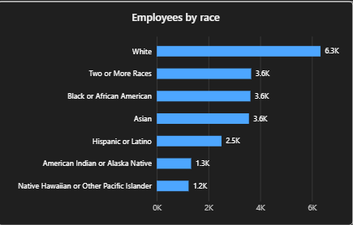

# HR Workforce Analytics

**Tools:** MySQL · Microsoft Power BI · Power Query · DAX  
**Domain:** Human Resources and Workforce Analytics  
**Project Type:** Descriptive Data Analytics  
**Project:** DataMites Phase 3 Capstone – PRDA-03: HR Analytics

## Dashboard Preview

The following preview brings together the KPI and chart screenshots included in this repository.


## 1. Business Problem

Organizations need a clear view of their workforce to understand employee demographics, work locations, department and state distribution, and hiring patterns.

This project uses employee records from a MySQL database and presents the main workforce measures in a Power BI dashboard.

The dashboard helps answer questions such as:

- How many employee records are included in the dataset?
- What percentage of employees work remotely and at headquarters?
- What is the average employee age?
- How did annual hiring change between 2000 and 2020?
- How is the workforce distributed by gender and race?
- Which states and departments have the highest employee counts?

## 2. Dataset

The project uses the `project_hr_analytics HR` table from the provided MySQL database.

| Dataset Detail | Value |
|---|---:|
| Records loaded into Power BI | 22,214 |
| Imported columns | 14 |
| Data source | MySQL |
| Analysis tool | Microsoft Power BI |
| Hiring trend period shown | 2000–2020 |

The imported fields include `id`, `first_name`, `last_name`, `birthdate`, `Age`, `gender`, `race`, `department`, `jobtitle`, `location`, `hire_date`, `termdate`, `location_city`, and `location_state`.

**Column Count Note:** The project brief lists 13 columns, while the table loaded into Power BI contains 14 imported columns, including `gender`. A derived `Employee_Status` column was also created during data preparation; it is not one of the original imported fields.

## 3. Tools and Methodology

### MySQL

- Used as the source database for the employee records.
- Connected the HR table directly to Power BI.

### Power Query

- Reviewed column names and data types.
- Checked employee IDs for duplicate records.
- Reviewed blank and null values.
- Retained the original `termdate` column as Text because it contained blank values and UTC timestamp text.
- Created a derived `Employee_Status` column using `termdate`.

### Power BI and DAX

- Created KPI cards for Total Employees, Remote Workforce, Headquarters Workforce, and Average Employee Age.
- Built a line chart for annual employee hiring.
- Built a donut chart for gender distribution.
- Built bar charts for employees by state, department, and race.

## 4. Data Preparation and Validation

The following preparation steps were recorded in the project report:

1. Connected Power BI to the provided MySQL database and loaded the HR table.
2. Reviewed the imported columns and data types.
3. Checked employee IDs for duplicate records.
4. Reviewed blank and null values across the columns.
5. Retained `termdate` as Text because the field contained UTC values and blank records.
6. Created `Employee_Status` using the following Power Query custom column formula:

```powerquery
if [termdate] = null then "Active" else "Terminated"
```

The derived status is classified as:
- **Active:** `termdate` is blank.
- **Terminated:** `termdate` contains a value.

The original `termdate` column was retained.

## 5. Key Results and Findings

The values below are taken from the Power BI dashboard and the project report.

### Main KPIs

| KPI | Dashboard Value |
|---|---:|
| Total Employees | **22,214** |
| Remote Workforce | **24.75%** |
| Headquarters Workforce | **75.25%** |
| Average Employee Age | **38.43 years** |

### Gender Distribution

| Gender Category | Employees | Share |
|---|---:|---:|
| Male | **11,288** | **50.81%** |
| Female | **10,321** | **46.46%** |
| Non-Conforming | **605** | **2.72%** |
| **Total** | **22,214** | **100.00%** |

Percentages are rounded to two decimal places.

### What the Results Show

1. **Hiring trend:** 2018 recorded the highest annual hiring count, with **1,147 hires**. The chart shows **220 hires** in 2000. The displayed annual trend covers 2000 to 2020.
2. **Work location:** **75.25%** of employee records are classified at Headquarters, while **24.75%** are classified as Remote.
3. **Gender distribution:** Male employees account for **50.81%**, female employees account for **46.46%**, and the Non-Conforming category accounts for **2.72%**.
4. **State distribution:** Ohio has the largest employee count, at approximately **18.0K**. Pennsylvania is approximately **1.1K**, Illinois approximately **0.9K**, and Wisconsin approximately **0.4K**.
5. **Department distribution:** Engineering is the largest department, at approximately **6.7K** employees, followed by Accounting at approximately **3.3K**. Auditing is the smallest department, at approximately **0.1K**.
6. **Race distribution:** White employees are the largest racial category, at approximately **6.3K**. Two or More Races, Black or African American, and Asian categories are each approximately **3.6K**. Native Hawaiian or Other Pacific Islander is approximately **1.2K**.
7. **Average age:** The average employee age is **38.43 years**.

**Approximation Note:** State, department, and race values above are rounded readings from the dashboard charts. They are not presented as exact counts.

## 6. Power BI Dashboard

The report presents the following KPI cards and charts on one dashboard page.

### KPI Cards

- Total Employees
- Remote Workforce (%)
- Headquarters Workforce (%)
- Average Employee Age

### Charts

- **Annual Employee Hiring Trend:** Line chart showing employee hiring counts by year from 2000 to 2020.
- **Gender of Employees:** Donut chart showing Male, Female, and Non-Conforming categories.
- **Employees by State:** Bar chart comparing employee counts across the seven states in the dataset.
- **Employees by Department:** Bar chart comparing employee counts across departments.
- **Employees by Race:** Bar chart showing employee counts across racial categories.

### Dashboard Screenshots

#### KPI Summary


#### Annual Employee Hiring Trend


#### Gender Distribution


#### Employees by State


#### Employees by Department


#### Employees by Race



## 7. Business Recommendations

These suggestions are based on the patterns visible in the dashboard. They are areas for further review, not guaranteed outcomes.

1. **Employee Retention:** Analyze employee termination patterns to identify areas with higher employee exits and review retention.
2. **Workforce Planning:** Review employee distribution across states and departments to understand workforce allocation.
3. **Recruitment Planning:** Use historical hiring trends to support future recruitment planning.

## 8. Dashboard Creation Process

1. Open Power BI Desktop and connect to the provided MySQL database.
2. Select and load the `project_hr_analytics HR` table.
3. Open Power Query and review the imported column names and data types.
4. Review blank and null values and check employee IDs for duplicates.
5. Retain `termdate` as Text and create the `Employee_Status` custom column.
6. Create DAX measures for Total Employees, Remote Workforce, Headquarters Workforce, and Average Employee Age.
7. Add KPI cards for the four measures.
8. Add a line chart using `hire_date` by year and employee count.
9. Add a donut chart using `gender` and employee count.
10. Add bar charts using `location_state`, `department`, and `race` with employee count.
11. Review chart titles, labels, displayed values, and dashboard layout.
12. Save the Power BI report.

## 9. Conclusion

This project brings together employee count, work location, average age, annual hiring trends, and workforce demographics in one Power BI dashboard. The results show that most employee records are classified at Headquarters, 2018 has the highest annual hiring count in the displayed period, and Engineering is the largest department. The dashboard provides a clear descriptive view of the workforce using Power BI.

## 10. Limitations and Notes

- The analysis is based on the 22,214 employee records loaded into Power BI.
- The project brief lists 13 columns, while the imported table contains 14 original columns, including `gender`.
- `Employee_Status` is a derived classification based on whether `termdate` is blank or populated.
- State, department, and race counts are approximate readings from chart labels.
- The dashboard shows annual hiring counts, not a hiring rate.
- The dashboard is descriptive and does not establish the reasons behind hiring patterns or workforce distribution.
- The report does not include a dedicated active-versus-terminated dashboard visual.
- Database passwords and private connection details should not be included in the repository.

## 11. Repository Structure

```text
HR-Analytics-Project/
|
|-- README.md
|
|-- PowerBI/
|   |-- hr_analytics.pbix
|
|-- Documentation/
|   |-- HR_Analytics_Doc.docx
|
|-- Presentation/
|   |-- HR_Analytics_Presentation.pptx
|
|-- Screenshots/
|   |-- 00_HR_Analytics_Visuals_Preview.png
|   |-- 01_HR_KPI_Summary.png
|   |-- 02_Annual_Hiring_Trend.png
|   |-- 03_Gender_Distribution.png
|   |-- 04_Employees_by_State.png
|   |-- 05_Employees_by_Department.png
|   |-- 06_Employees_by_Race.png
```

## Project Summary

**Project:** DataMites Phase 3 Capstone – PRDA-03: HR Analytics  
**Report:** HR Workforce Analytics – KPI Values and Analysis  
**Database:** MySQL  
**Visualization:** Microsoft Power BI  
**Author:** Mrunal Jadhav
